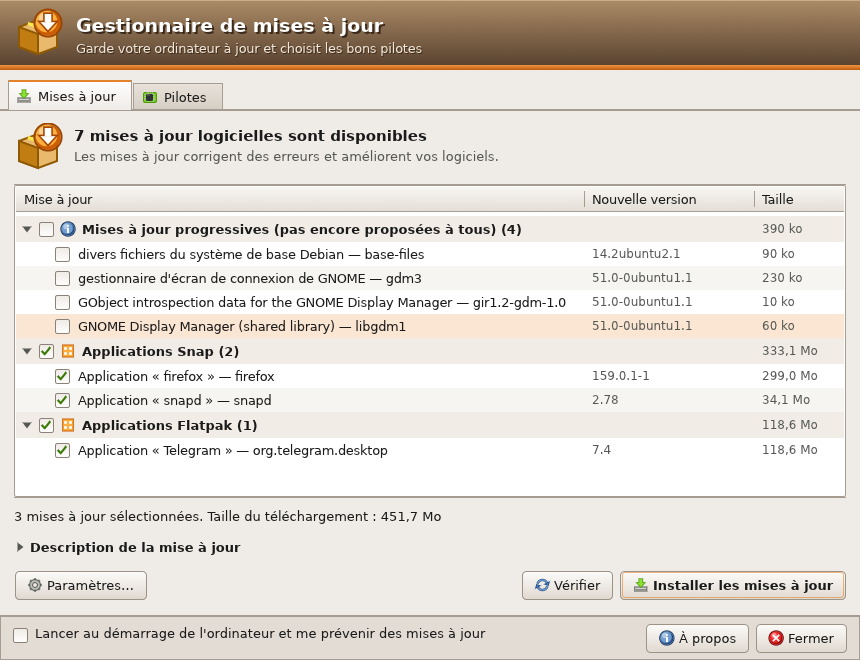
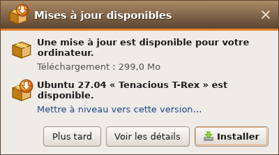
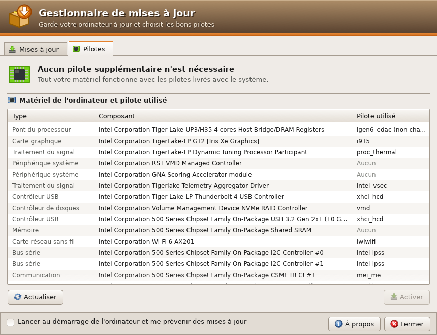
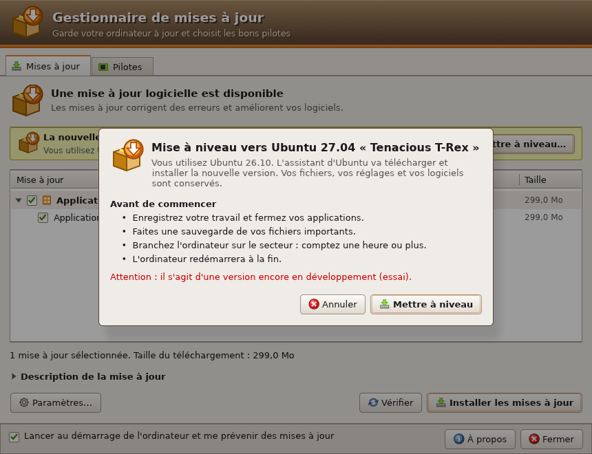

# Gestionnaire de mises à jour

Mises à jour et pilotes au look Ubuntu « Human » de 2008, écrit en Rust (egui).

## Installer

Téléchargez le fichier `.deb` de la [dernière version](https://github.com/jbandrivet/gestionnaire-maj/releases/latest), puis :

    sudo apt install ./gestionnaire-maj_1.1.0_amd64.deb

Puis : menu des applications → **Gestionnaire de mises à jour**.

## Ce qu'il fait

- **Mises à jour** : liste classée (sécurité, recommandées, autres sources,
  progressives, Snap, Flatpak), cases à cocher, taille du téléchargement,
  description et liste des modifications de chaque paquet. « Installer les
  mises à jour » demande le mot de passe une fois, puis montre l'avancement.
- **Pilotes** : pilotes recommandés pour le matériel (via `ubuntu-drivers`),
  bouton Activer / Désactiver, et tableau du matériel avec le pilote utilisé.
- **Mise à niveau** : quand une nouvelle version d'Ubuntu sort, un bandeau
  jaune l'annonce avec **Mettre à niveau…** ; après une confirmation (sauvegarde,
  secteur…), l'assistant officiel d'Ubuntu prend le relais. Paramètres → « Me
  prévenir d'une nouvelle version » : toute version, LTS seulement ou jamais.
- **Lancer au démarrage** : la case en bas de la fenêtre (ou dans Paramètres)
  démarre une veille avec la session. Quand des mises à jour arrivent, une
  bulle s'affiche en haut à droite avec **Installer**, **Voir les détails** et
  **Plus tard**. Décocher la case arrête la veille.

| Bulle au démarrage | Pilotes | Mise à niveau |
|---|---|---|
|  |  |  |

## Réglages

Paramètres… : fréquence de recherche (1 h à 1 semaine), rappel des mises à
jour non installées, Snap, Flatpak, pilotes, lancement au démarrage.
Fichiers : `~/.config/gestionnaire-maj/reglages.json`,
`~/.config/autostart/gestionnaire-maj.desktop`, journal de la veille dans
`~/.cache/gestionnaire-maj/veille.log`.

## Sécurité

Les opérations en administrateur passent par `pkexec` et un petit assistant
(`/usr/libexec/gestionnaire-maj/aide`) qui n'accepte que quelques commandes et
vérifie chaque nom de paquet. Relire la liste des logiciels est permis sans
mot de passe à la personne devant l'écran ; installer demande le mot de passe
(gardé quelques minutes).

## Fabriquer le paquet

    packaging/make-deb.sh

Il faut Rust (cargo) et `dpkg-deb`. Essais sans rien modifier : `GMAJ_SIMULER=1 gestionnaire-maj` (apt en
simulation, sans pkexec).

## Licence

GPL 3 ou ultérieure — voir [LICENSE](LICENSE).
